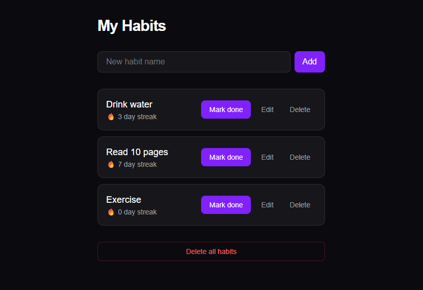

# Habit Tracker

A clean, dark-mode habit tracker for building daily streaks. Built with Next.js, TypeScript, and Tailwind CSS.

**[🔗 Live Demo](https://habit-tracker-wine-zeta-53.vercel.app)**



## Features

- Add, edit, and delete habits
- Edit in place: press Enter to save, or Cancel to undo
- Daily streaks that reset automatically after a missed day
- "Delete all" with a confirmation prompt
- Empty state message when there are no habits
- Habits are saved in `localStorage`, so they survive a refresh
- Dark UI built with Tailwind CSS
- Responsive layout, checked on phone-sized screens

## Tech Stack

- **Next.js** (App Router)
- **React** with hooks (`useState`, `useEffect`)
- **TypeScript** for the habit data model and component props
- **Tailwind CSS** for styling
- **Vercel** for deployment

## Project Structure

```
app/
├── page.tsx              # State, saving, and daily reset logic
├── types.ts              # Habit type
└── components/
    ├── HabitForm.tsx     # Add a new habit
    ├── HabitList.tsx     # List of habits
    └── HabitCard.tsx     # One habit: mark done, edit, delete
```

## Getting Started

```bash
git clone https://github.com/Doziedc/habit-tracker.git
cd habit-tracker
npm install
npm run dev
```

Open [http://localhost:3000](http://localhost:3000).

## What I Learned

I come from a UI/UX and vanilla HTML/CSS/JS background. This project is where I put React, Next.js, TypeScript, and Tailwind into practice.

- **Saving to `localStorage` safely.** If the save effect runs before the load effect finishes, the empty starting list can overwrite real data. I used a `loaded` flag so saving only starts after loading is done.

- **A bug I fixed: habits never reset.** At first, a habit stayed "Done today" forever. I added a `lastCompleted` date to each habit. When the app loads, it compares that date with today. It unlocks the habit, and it resets the streak if a full day was missed.

- **Conditional rendering.** The card switches between a display view and an edit view with `{isEditing ? (...) : (...)}`.

- **Input guard.** Save is disabled when the draft name is empty, using `draftName.trim() === ""`, so names with only spaces are rejected.

- **Responsive layout.** Buttons overlapped the text at 360px wide, so I tested at phone sizes and with a very long habit name. The edit form stacks on small screens with `flex-col sm:flex-row`. The name uses `min-w-0` and `break-words` so long text wraps.

## Known Limitations

- Data is stored in the browser only, so it does not sync across devices.
- The daily reset check runs when the page loads. If the tab stays open past midnight, refresh it.

## Possible Improvements

- Streak calendar to show history
- Undo for an accidental "Mark done"
- Unit tests and an accessibility audit

## Author

**Akujobi Daniel**
- GitHub: [@Doziedc](https://github.com/Doziedc)
- Live: [habit-tracker-wine-zeta-53.vercel.app](https://habit-tracker-wine-zeta-53.vercel.app)